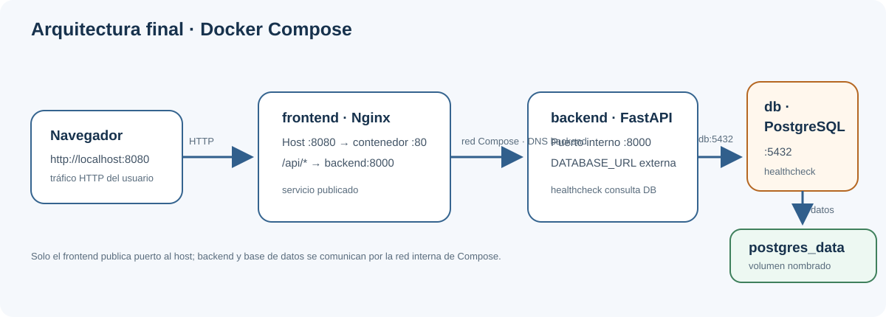

# ACI606 - Docker Rescue Challenge

Aplicación web multi-servicio recuperada sobre el starter entregado para la Evaluación 2 de ACI606. La solución conserva sus tres componentes: frontend Nginx, API FastAPI y PostgreSQL.

- **Asignatura:** ACI606 — Especialidad II.
- **Integrante único:** Sebastián Goudet (`@goudetsebastian-cyber`).
- **Repositorio de entrega:** [ACI606 Docker Rescue Challenge](https://github.com/goudetsebastian-cyber/aci606-docker-rescue-challenge) (público).



## Requisitos

- Docker Engine y Docker Compose v2.
- Puerto local `8080` disponible (se puede cambiar con `FRONTEND_PORT`).

## Inicio reproducible

Desde la raíz del proyecto, crea la configuración local a partir del ejemplo:

```powershell
Copy-Item .env.example .env
```

En Linux/macOS/Codespaces:

```bash
cp .env.example .env
```

Valida la configuración expandida y levanta los servicios:

```bash
docker compose config --quiet
docker compose up --build -d
docker compose ps
docker compose logs --tail=100
```

Espera a que `frontend`, `backend` y `db` indiquen estado `healthy`. La API se consume a través de Nginx:

```powershell
curl.exe -i http://localhost:8080/api/health
curl.exe -i http://localhost:8080/api/items
curl.exe -X POST http://localhost:8080/api/items -H "Content-Type: application/json" -d '{"name":"registro-demo"}'
```

En Linux/macOS/Codespaces:

```bash
curl -i http://localhost:8080/api/health
curl -i http://localhost:8080/api/items
curl -X POST http://localhost:8080/api/items -H "Content-Type: application/json" -d '{"name":"registro-demo"}'
```

La respuesta de salud esperada es HTTP 200 con `{"status":"ok","database":"reachable"}`.

## Comprobar persistencia

Crea un registro y guarda su respuesta. Luego recrea los contenedores sin borrar el volumen:

```bash
docker compose down
docker compose up --build -d
curl http://localhost:8080/api/items
```

En Windows PowerShell, usa `curl.exe` en lugar de `curl` para consultar la respuesta.

El registro debe seguir presente porque PostgreSQL utiliza el volumen nombrado `postgres_data`. `docker compose down -v` elimina ese volumen y todos sus datos; úsalo solo para reiniciar intencionalmente el estado local.

## Fallo controlado y recuperación

Detén el backend. La ruta de salud a través de Nginx debe fallar mientras la API está detenida; el proxy normalmente responde HTTP 502. Revisa los logs y vuelve a iniciarlo:

```bash
docker compose stop backend
curl -i http://localhost:8080/api/health
docker compose logs --tail=50 backend frontend
docker compose start backend
docker compose ps
curl -i http://localhost:8080/api/health
```

Espera a que el backend figure `healthy` antes de considerar recuperado el servicio.

En Windows PowerShell, usa `curl.exe` en lugar de `curl` para esas solicitudes.

## Diagnóstico útil

```bash
docker compose config
docker compose ps
docker compose logs backend
docker compose logs db
docker compose logs frontend
docker compose exec backend python -c "import urllib.request; print(urllib.request.urlopen('http://127.0.0.1:8000/health').read().decode())"
docker volume ls
docker volume inspect aci606-docker-rescue_postgres_data
```

## Configuración

Compose lee `.env` automáticamente. Variables principales:

- `FRONTEND_PORT`: puerto publicado en el host; el contenedor Nginx escucha en `80`.
- `POSTGRES_USER`, `POSTGRES_PASSWORD`, `POSTGRES_DB`: inicialización local de PostgreSQL.
- `DATABASE_URL`: URL SQLAlchemy para el backend; debe usar el host de servicio `db` y coincidir con las credenciales de PostgreSQL. Si la contraseña contiene caracteres reservados de URL (`@`, `:`, `/`, `#`, entre otros), codifícala como URL.

`.env.example` contiene valores de demostración. No uses esas credenciales en una instancia expuesta a Internet. PostgreSQL aplica las variables de inicialización al crear un directorio de datos nuevo; cambiar credenciales con un volumen ya inicializado no modifica automáticamente los roles existentes.

## Detener y recrear

```bash
docker compose down       # Detiene y elimina contenedores; conserva postgres_data
docker compose up --build -d
```

Para una limpieza completa del entorno de práctica, incluida la base de datos, ejecuta `docker compose down -v`.

## Informe técnico

El [informe técnico en PDF](docs/Informe_Tecnico_ACI606_Docker_Rescue.pdf), su [fuente Markdown](docs/Informe_Tecnico_ACI606_Docker_Rescue.md), el [diagrama](docs/arquitectura.svg) y el [registro de validación estática](docs/evidencia/validacion_estatica.txt) están en `docs/`. El informe diferencia las verificaciones estáticas realizadas de las pruebas dinámicas pendientes cuando no hay un motor Docker disponible.

## Repositorio GitHub

El repositorio público de entrega es [ACI606 Docker Rescue Challenge](https://github.com/goudetsebastian-cyber/aci606-docker-rescue-challenge). La rama `main` conserva el historial descriptivo de diagnóstico, reparación y mejoras.
